<p align="center">
  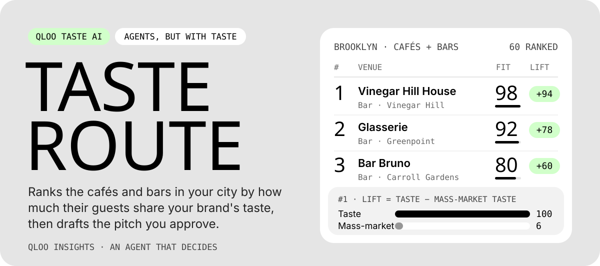
</p>

<p align="center">
  <a href="./docs/evaluation-results.md">Evaluation</a> ·
  <a href="#run-it-locally">Run it locally</a> ·
  <a href="./docs/00-product-brief.md">Product brief</a> ·
  <a href="./LICENSE">MIT licence</a>
</p>

<p align="center">
  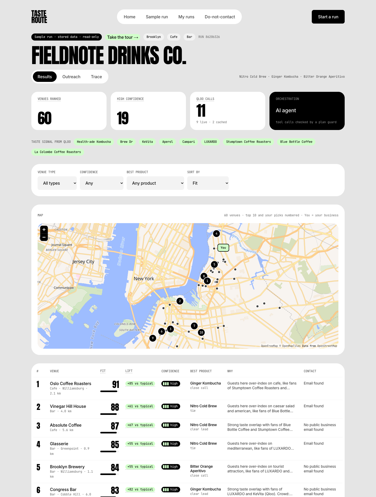
</p>
<p align="center"><sub>The sample run: a fictional Brooklyn drinks maker (cold brew, kombucha, aperitivo), 60 cafés and bars ranked from 11 Qloo calls. "Take the tour" on the sample walks through every screen.</sub></p>

## What it is

A small food or drink brand needs its first wholesale accounts. Lists of cafés and their emails are easy to find; knowing **which venues' guests already like what you make** is not. TasteRoute answers that with Qloo's taste data about each venue's own customers:

- **Which venues to pitch**, ranked by taste fit, not by how busy they are.
- **Which product to lead with** at each one.
- **Where they are**, on a map numbered by rank, and how far each one is from your business if you set its location.
- **Why**, as a reason built from Qloo's explanation, with every source one click away.
- **A first email** that cites only that evidence, for you to edit, approve and send from your own inbox.

Built for the Qloo Agentic Hackathon 2026 ("Agents, but with taste").

## Why it needs Qloo

| Without Qloo | With TasteRoute |
|---|---|
| Every café in the city, sorted by rating or distance | The venues whose guests over-index on the brands you resemble |
| The busiest places float to the top | Lift subtracts Qloo's popularity baseline, so busy alone doesn't win |
| The same product pitched everywhere | A separate Qloo query per product picks the lead product per venue |
| A generic email | An email that names the specific taste overlap, checked against the evidence |

Switch Qloo off and TasteRoute says it cannot rank venues and stops. It never falls back to guesses.

## How it works

<p align="center">
  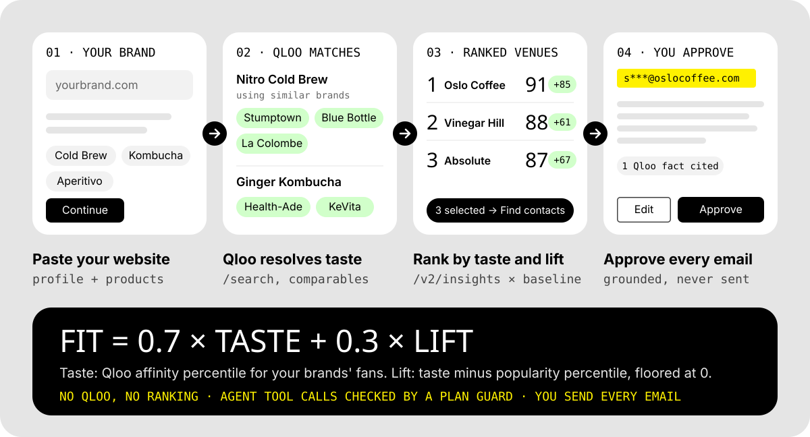
</p>

1. **Your brand.** Paste a website (up to 3 pages are read) or describe your products. The LLM drafts a profile you confirm.
2. **Qloo resolves taste.** Each product is looked up with Qloo `/search`. Products too new for Qloo use real comparable brands, each one verified by `/search`. Entity ids only ever come from Qloo.
3. **Rank.** For each venue type, a Qloo `/v2/insights` place query with your brands as the signal and `feature.explainability` gives the **taste** percentile and which of your brands drive it. The same query without a signal gives the **popularity** baseline. `lift = taste − popularity`, `fit = 0.7 × taste + 0.3 × max(lift, 0)`.
4. **Evidence and product fit.** One insights query per product with `filter.results.entities` scores every ranked venue for that product. Audience tags (`filter.type=urn:tag`) and each venue's Qloo tags explain the match. Reasons label each claim as "Qloo" or "Our inference".
5. **Contacts.** Only public business addresses: the venue's OpenStreetMap listing and its own website (Hunter domain search when a key is set). Every contact shows where it was published.
6. **Drafts.** The LLM writes a short pitch from an evidence bundle. A grounding validator rejects any name or number that is not in that bundle, and any draft that cites unknown evidence, misnames the venue or drops the opt-out line. After one repair attempt, a template that always passes takes over. Nothing is sent for you.

An AI agent (Gemma 4 31B on Ollama Cloud, native tool calls) runs these steps as tools. A plan guard checks every call's phase, order and arguments. After two invalid steps, an unavailable model or the step limit, a deterministic plan runs the same tools and produces identical scores.

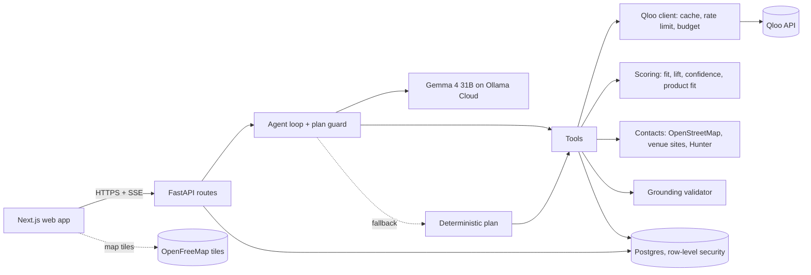

Keys stay on the API. The browser calls only FastAPI, plus public map tiles that need no key.

## See every step

<table>
  <tr>
    <td width="50%">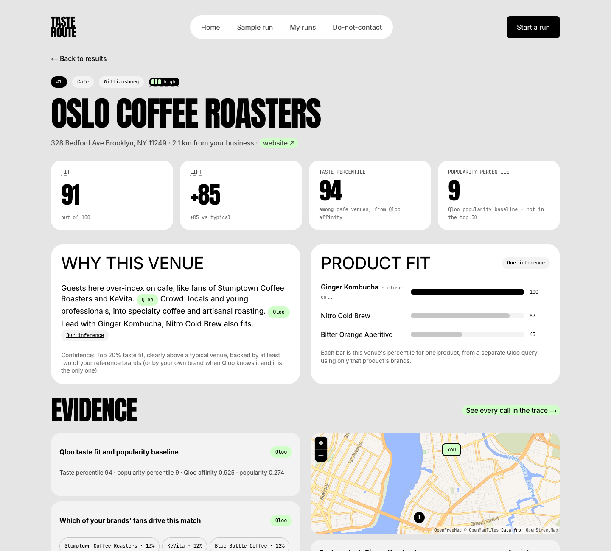</td>
    <td width="50%">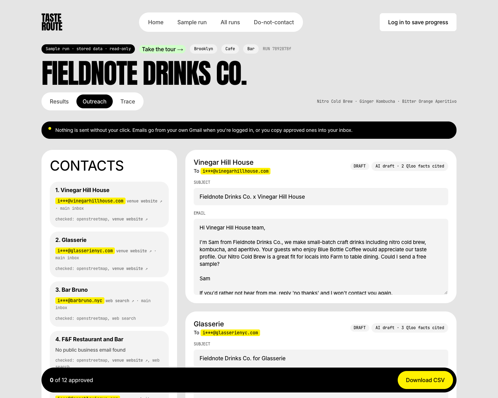</td>
  </tr>
  <tr>
    <td><b>Venue detail.</b> Fit, lift and both percentiles, per-product fit, each piece of Qloo evidence, and where the venue is.</td>
    <td><b>Outreach.</b> Contacts with their sources, editable drafts, approve, open in mail app, CSV export.</td>
  </tr>
  <tr>
    <td>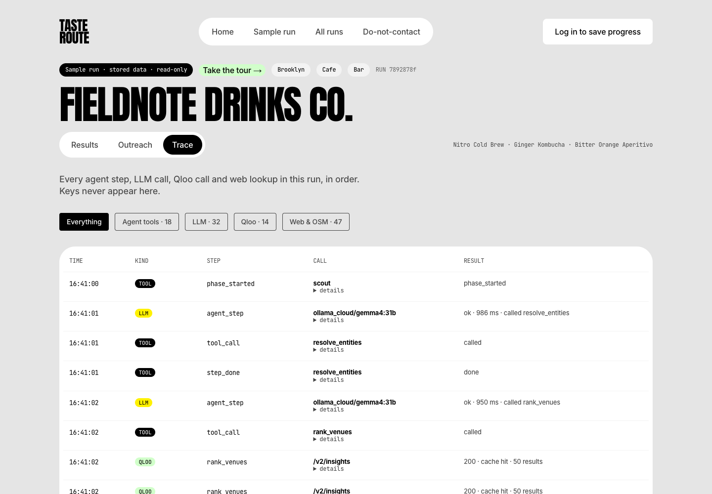</td>
    <td>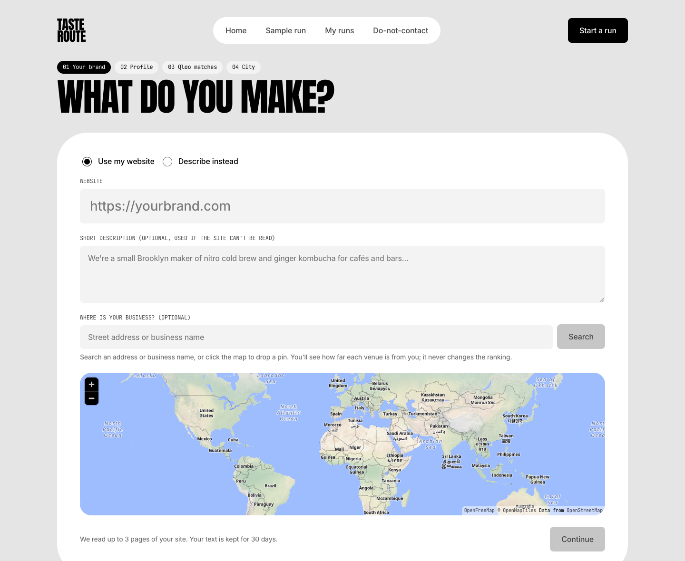</td>
  </tr>
  <tr>
    <td><b>Trace.</b> Every agent step, LLM call, Qloo call and web lookup, in order. Keys never appear.</td>
    <td><b>Start.</b> Four steps: brand and your location (optional, type or click the map), profile, Qloo matches, then city (framed on the map) and venue types.</td>
  </tr>
  <tr>
    <td>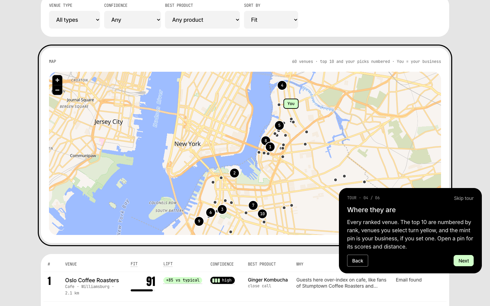</td>
    <td>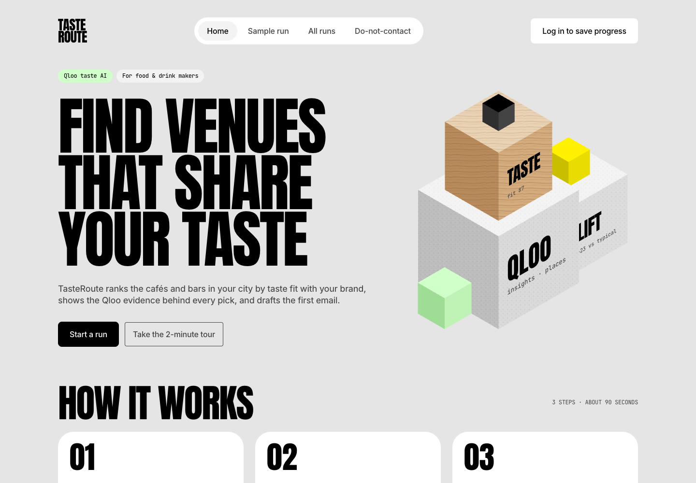</td>
  </tr>
  <tr>
    <td><b>Guided tour.</b> Walks through the sample from results to venue, outreach and trace. Esc or Skip closes it.</td>
    <td><b>Landing.</b> Start a run, or take the tour of the sample run.</td>
  </tr>
</table>

<p align="center">
  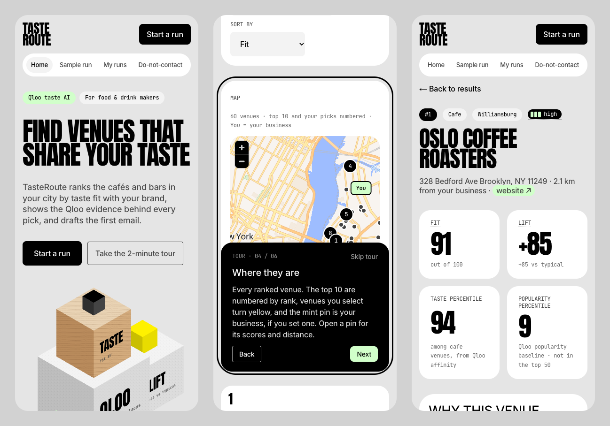
</p>

## Does Qloo change the answer?

`apps/api/scripts/evaluate.py` compares three setups for two fictional brands with different tastes, a specialty coffee roaster and a mainstream cola, in Brooklyn (top 15 cafés and bars each). Full tables: [`docs/evaluation-results.md`](./docs/evaluation-results.md).

| Setup | Coffee roaster | Cola |
|---|---|---|
| **A. TasteRoute** vs **B. Qloo popularity only**, overlap | 0.00 | 0.00 |
| **A** vs **C. No Qloo** (LLM ranks OpenStreetMap venues), overlap | 0.00 | 0.00 |
| A's top 15 that were even in C's candidate pool | 1 | 1 |

- **Brand sensitivity:** the two brands' top-15 lists share 0 venues, and each reads like its brand. The coffee list mixes specialty cafés (White Noise, Kaigo, Coffee Mob, Oslo, Blue Bottle) with restaurant-bars and cocktail bars. The cola list is dive and neighbourhood bars, three Starbucks branches and a bagel shop.
- **Read the A vs C number carefully:** C could only pick from its OSM sample, so most of that difference comes from the candidate pools, not judgement.
- **Still open:** the blind preference test (10 A-only vs C-only pairs per brand, judged from the venues' own sites) and the reason-quality check need a human judge. Until those are scored, the honest claim is "a taste-informed starting list", not "better targeting".

## Guardrails

- **Qloo decides, the LLM narrates.** Venues, scores, product picks and reasons come from Qloo responses. The LLM chooses tools and writes words.
- **Fail closed.** No key, a rejected key or Qloo down: the run stops with an error panel and shows no partial ranking.
- **Humans approve every email.** The app has no mail-sending code. It drafts, you approve, you send.
- **Business contacts only.** Contacts are never constructed or guessed. A do-not-contact list removes emails and domains from lookups, drafts and exports.
- **Honest copy.** "Taste fit", never purchase intent. Inferences are labelled.
- **Budgets.** Qloo calls are cached, rate limited, capped per run and per month, and counted on screen.

## Run it locally

Requires Node 24 with pnpm, Python 3.12 with [uv](https://docs.astral.sh/uv/), and Postgres 15.

```bash
pnpm install
cd apps/api && uv sync
cp .env.example .env          # add QLOO_API_KEY and OLLAMA_API_KEY; HUNTER_API_KEY is optional
createdb tasteroute && uv run python scripts/migrate.py
uv run python scripts/seed_demo.py   # optional: builds the sample run with live calls (about 10 Qloo calls)
cd ../.. && pnpm dev                 # web on http://localhost:3000, API on http://localhost:8000
```

Open http://localhost:3000/sample?tour=1 for the guided tour of the sample run.

Set `LLM_PROVIDER=fake` to run without an LLM key. Ranking still needs Qloo.

### Tests

```bash
createdb tasteroute_test
(cd apps/api && uv run python scripts/migrate.py --url postgresql://localhost:5432/tasteroute_test)
pnpm turbo lint check-types test
```

116 API tests (pytest) and 15 web tests (Vitest). Tests never call Qloo, the LLM, OpenStreetMap or Photon: recorded fixtures, a fake model, and a network block stand in. CI runs the same checks on Postgres 15 and fails if `packages/contracts` drifts from the API.

With the API running, `uv run python scripts/e2e_smoke.py` (in `apps/api`) walks the whole judge path over HTTP: intake, Qloo matches, run, ranking, rescore, contacts, drafts, approval, CSV export, do-not-contact, trace. It makes live calls (about 10 Qloo and 15–25 LLM) and prints what it spent.

## Project layout

```text
apps/api            FastAPI: Qloo client, scoring, agent and plan guard, outreach, SSE progress
apps/web            Next.js: wizard, live run, results and map, venue detail, outreach, trace, guided tour
packages/contracts  TypeScript types generated from the API's OpenAPI schema
supabase/migrations Postgres schema (row-level security on every table)
docs/               Product brief, architecture, Qloo contract, evaluation, runbook
```

## Limits

- Ranking covers only places Qloo knows. A great venue missing from Qloo never appears.
- One demo city (Brooklyn) and one category pack (food and drink) are tuned and tested.
- Contacts depend on what venues publish: 4 of the top 8 in the sample, 1 of 6 and 0 of 5 in two later test runs (Brooklyn bars, Chicago). Ranking never depends on them.
- The public demo allows 3 live runs per visitor per day (`PUBLIC_RUNS_PER_IP_PER_DAY`; `0` turns it off locally). The sample run is always free.
- The map uses OpenFreeMap's free vector tiles (OpenStreetMap data), trimmed to food and drink places and famous sights. Distances are straight lines, not travel routes, and your location never changes the ranking.
- Taste fit is a starting list, not a sales forecast.

## Licence

[MIT](./LICENSE)
