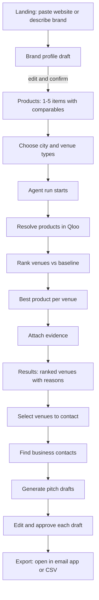

# 02. User flows

## Flow A: Brand founder, first run (the demo flow)

Steps in detail:

1. **Intake.** The user pastes a website URL. The app reads the homepage and up to 2 linked pages (about, products), then the agent proposes a brand profile: what the brand sells, price tier, style words, and up to 5 products. The user edits and confirms. A user without a website types a short description instead.
2. **Products and comparables.** For each product, the app searches Qloo for the product or brand itself. If not found, the agent proposes up to 3 comparable well-known brands, and the app resolves them in Qloo. The user can remove or add comparables. Unresolved names are shown as unresolved.
3. **City and venue types.** The user picks a city (geocoded once with Nominatim) and venue types from the category pack (for example cafés, bars, restaurants, delis).
4. **Run.** The agent executes the tools in order, streaming progress. Each Qloo call appears in the trace as it happens.
5. **Results.** A ranked list of venues with fit score, lift over baseline, best product, a reason, and confidence. Filters: venue type, minimum confidence, product.
6. **Contacts.** The user selects venues (up to 25 per run in the MVP) and clicks "Find contacts". The app looks for a website and an email from OpenStreetMap tags, then Hunter domain search on the venue's domain. Each contact shows its source and verification status.
7. **Drafts.** The agent writes one pitch per selected venue that has a contact, using only the stored evidence. The grounding validator checks every claim.
8. **Approve and export.** The user edits and approves drafts. Approved drafts can be opened in the user's email app (mailto link) or exported as CSV. Nothing is sent by the app.

## Flow B: Field rep with a portfolio

Same as Flow A, but at step 2 the rep enters several products from different brands (up to 5 in the MVP). The results page emphasises the "best product per venue" column and offers a filter "show venues where product X is the best fit".

## Flow C: Judge or visitor without keys (demo mode)

1. The landing page offers **"See a sample run"**.
2. The app loads a stored run for the demo brand and city from Supabase, with all evidence, contacts (masked) and drafts.
3. The visitor can browse, open the trace, edit a draft locally and export. Live Qloo and Hunter calls are disabled for anonymous demo visitors unless they start a new run, which is rate limited (see F10).

## Flow D: Unsupported business

If the intake shows the user's prospects are not consumer-facing businesses (for example "accounting software for law firms"), the app explains: "TasteRoute ranks businesses by what their customers like. Your prospects are chosen on company size and industry, which Qloo does not cover." It suggests a company-data tool instead and does not run the agent.

## Flow E: Opt-out

A venue that asks not to be contacted is added to the suppression list by email or domain. Suppressed contacts never appear in drafts or exports again (F08).

## Error flows (summary)

| Situation | What the user sees |
|---|---|
| Website cannot be read | "We couldn't read that site. Describe your brand instead." with a text box |
| No product resolves in Qloo and no comparables resolve | "Qloo doesn't know these products or similar brands yet." The run cannot continue |
| Qloo unavailable or key invalid | Run fails with a clear message and retry. No ranking is shown, no fallback ranking |
| City has too few venues in Qloo | Results show what exists with a "low coverage" notice |
| No contact found | Venue row shows "No public business email found" and the sources checked |
| LLM unavailable | Ranking still works. Drafts use a plain template with the evidence and are labelled as template |
| Budget cap reached | Run stops with partial results and a notice |
