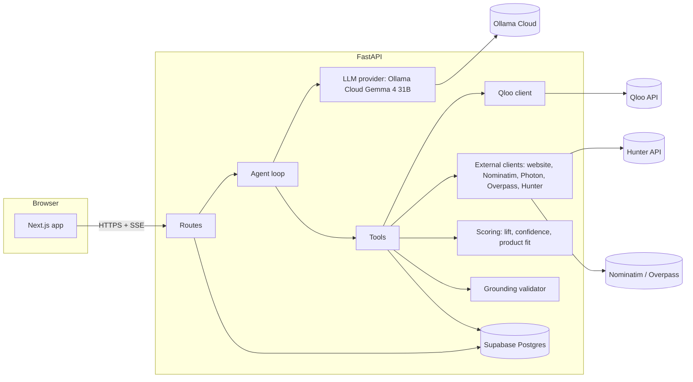
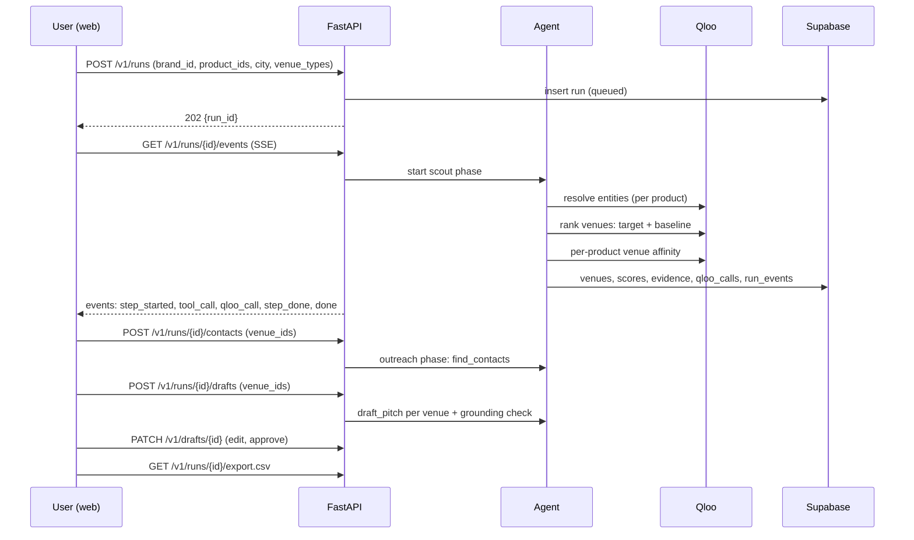

# 03. Architecture

## Monorepo layout

```
.
├─ apps
│  ├─ web                              # Next.js (App Router), existing
│  │  ├─ app/
│  │  │  ├─ page.tsx                   # landing
│  │  │  ├─ start/page.tsx             # intake wizard (brand, products, city)
│  │  │  ├─ runs/[id]/page.tsx         # live progress + results
│  │  │  ├─ runs/[id]/venues/[venueId]/page.tsx   # venue detail + evidence
│  │  │  ├─ runs/[id]/outreach/page.tsx           # contacts + drafts + approval
│  │  │  ├─ runs/[id]/trace/page.tsx              # call trace
│  │  │  ├─ sample/page.tsx            # demo run (no keys)
│  │  │  └─ settings/suppression/page.tsx
│  │  ├─ lib/api.ts                    # typed client (types from packages/contracts)
│  │  └─ lib/sse.ts                    # run event stream
│  └─ api                              # FastAPI (Python 3.12, uv)
│     ├─ pyproject.toml
│     ├─ package.json                  # wrapper scripts so turbo can run dev/test/lint
│     ├─ .env.example
│     ├─ src/tasteroute_api/
│     │  ├─ main.py                    # app factory, lifespan, routers, CORS
│     │  ├─ settings.py                # pydantic-settings; every env var
│     │  ├─ errors.py                  # typed errors -> problem responses
│     │  ├─ db/                        # asyncpg pool, repositories (one per table group)
│     │  ├─ qloo/                      # client, rate limit, cache, budget, trace, models
│     │  ├─ external/                  # website_reader.py, nominatim.py, overpass.py, hunter.py, apollo.py (off)
│     │  ├─ scoring/                   # lift, confidence, product fit (pure functions)
│     │  ├─ agent/                     # loop.py, tools.py, plan_guard.py, deterministic_plan.py
│     │  ├─ llm/                       # base.py, ollama_cloud.py, gemini.py, fake.py, structured.py, prompts/*.md
│     │  ├─ grounding.py               # validates drafts against evidence
│     │  ├─ categories/                # food_drink.yaml, fashion.yaml (category packs)
│     │  ├─ routes/                    # health, workspaces, brands, runs, venues, outreach, suppression, demo
│     │  └─ schemas.py                 # public API models
│     ├─ scripts/                      # spike_qloo.py, spike_llm_tools.py, record_fixture.py, seed_demo.py, evaluate.py, export_openapi.py
│     └─ tests/                        # unit, contract, integration, api, e2e_fake, live
├─ packages
│  ├─ contracts                        # TS types generated from apps/api/openapi.json
│  ├─ ui                               # shared components (extend existing)
│  ├─ eslint-config, typescript-config # existing
├─ supabase
│  ├─ config.toml                      # from `supabase init`
│  ├─ migrations/                      # SQL migrations (source of truth for schema)
│  └─ seed.sql                         # optional local seed
├─ docs/                               # this pack
├─ AGENTS.md, CLAUDE.md
└─ turbo.json, pnpm-workspace.yaml, package.json
```

## Component diagram



The browser talks **only** to FastAPI, plus public OpenStreetMap tiles for the map (no key). It never calls Supabase, Qloo, Hunter or Ollama directly, so no key ever reaches the browser.

## Run lifecycle



A run has two phases. **Scout** (ranking, automatic) and **Outreach** (contacts and drafts, triggered by the user for selected venues). Splitting them saves Hunter credits and keeps the user in control.

## Key design rules

1. **Qloo decides; the LLM narrates.** Venue lists, scores, product matches and reasons come from Qloo responses through pure scoring functions. The LLM chooses which tool to call next and writes text. It cannot add a venue or a number.
2. **Deterministic core.** `scoring/` is pure functions over stored Qloo responses. Same inputs and cache produce identical rankings regardless of the LLM.
3. **Agent with a safety net.** The agent uses native tool calling on Gemma 4 Cloud. A plan guard enforces allowed tool order and limits. If tool calling fails twice, the run switches to the deterministic plan (same tools, fixed order) and records that it did. See `05-agent-and-llm.md`.
4. **Fail closed on Qloo.** If Qloo fails, the scout phase fails with a clear error. No fallback ranking from the LLM or OpenStreetMap.
5. **Evidence everywhere.** Every displayed claim links to a stored `qloo_calls` or `external_calls` row.
6. **Budget aware.** Per-run caps for Qloo and Hunter calls, a shared response cache, and demo mode for visitors.
7. **No secrets in the browser.** All keys live in the API environment.

## Identity and workspaces (no login in the MVP)

- On first visit the web app calls `POST /v1/workspaces/session`. The API creates an anonymous workspace and returns a **workspace token**: the workspace id plus an HMAC signature made with `SESSION_SECRET`.
- The web app stores the token in `localStorage` (`ss_ws`) and sends it on every request as the header `X-Workspace-Token`. The SSE endpoint, which cannot send custom headers through `EventSource`, accepts it as the `token` query parameter.
- A header token is used instead of a cookie because the web (Vercel) and API (another host) are on different sites in the hackathon deployment, where third-party cookies are unreliable. The token only grants access to anonymous workspace data; real accounts replace it after the hackathon.
- Every brand, run, draft and suppression row carries `workspace_id`. The API verifies the signature and filters every query by it.
- The demo run belongs to a special read-only workspace and is visible to everyone.
- Rate limits use workspace id and client IP.
- Real accounts (Supabase Auth) are a post-hackathon item.

## Database access

- Supabase Postgres, accessed from FastAPI with **asyncpg** using `DATABASE_URL`.
- If `DATABASE_URL` points at the Supavisor **transaction** pooler, prepared statements are unsupported: create the pool with `statement_cache_size=0` and never call `Connection.prepare()`. Use the direct connection or session pooler when possible for a long-running server.
- Schema is managed by SQL files in `supabase/migrations/` (Supabase CLI). See `06-data-model-supabase.md`.
- Row Level Security is enabled on every table with **no** public policies, so the anon key cannot read anything. Only the server, using the database connection string, accesses data.

## Configuration (`apps/api/.env.example`)

```
APP_ENV=development                 # development | test | production
SESSION_SECRET=change-me
CORS_ORIGINS=http://localhost:3000
LOG_LEVEL=info

# Supabase
DATABASE_URL=postgresql://postgres.<ref>:<password>@<host>:5432/postgres
SUPABASE_URL=https://<ref>.supabase.co            # optional, for future Storage/Auth
SUPABASE_SERVICE_ROLE_KEY=                         # optional, server only

# Qloo
QLOO_API_KEY=
QLOO_BASE_URL=https://hackathon.api.qloo.com
QLOO_RPS=4
QLOO_MAX_CALLS_PER_RUN=120
QLOO_CACHE_TTL_HOURS=72
QLOO_TIMEOUT_SECONDS=20

# LLM (agent)
LLM_PROVIDER=ollama_cloud           # ollama_cloud | gemini | fake
OLLAMA_BASE_URL=https://ollama.com
OLLAMA_API_KEY=
OLLAMA_MODEL=gemma4:31b             # confirm the exact name at https://ollama.com/api/tags in Phase 0
LLM_TIMEOUT_SECONDS=90
LLM_TEMPERATURE_TOOLS=0.2
LLM_TEMPERATURE_WRITING=0.7
LLM_MAX_STEPS_PER_PHASE=12
GEMINI_API_KEY=
GEMINI_MODEL=

# Contacts and places
HUNTER_API_KEY=
HUNTER_MAX_CALLS_PER_RUN=25
APOLLO_ENABLED=false
APOLLO_API_KEY=
OSM_USER_AGENT=TasteRoute/0.1 (contact: you@example.com)
NOMINATIM_BASE_URL=https://nominatim.openstreetmap.org
OVERPASS_BASE_URL=https://overpass-api.de/api/interpreter
WEBSITE_FETCH_TIMEOUT_SECONDS=12

# Demo and limits
DEMO_MODE_ENABLED=true
DEMO_RUN_ID=
PUBLIC_RUNS_PER_IP_PER_DAY=3      # 0 = no limit (local only)
MAX_VENUES_PER_RUN=60
MAX_OUTREACH_VENUES_PER_RUN=25
PACK_FASHION_ENABLED=false          # set true only after Phase 0 proves boutique coverage

# Tests only
TEST_DATABASE_URL=                  # never the production database
```

`apps/web/.env.local`: `NEXT_PUBLIC_API_URL=http://localhost:8000`.

## Stack summary

| Layer | Choice | Notes |
|---|---|---|
| Frontend | Next.js (existing), React, TypeScript | Visuals from `docs/DESIGN.md` |
| Backend | FastAPI, Uvicorn, httpx, Pydantic v2, pydantic-settings | Python 3.12, `uv` |
| Database | Supabase Postgres via asyncpg | SQL migrations with Supabase CLI |
| Agent LLM | Ollama Cloud, Gemma 4 31B | Native tool calling (verify in Phase 0) |
| Taste data | Qloo Taste AI (hackathon API) | Core |
| Contacts | Hunter API v2 (domain search, email verifier) | Business domains only |
| Places | Nominatim (city and address search on Enter, dropped-pin reverse), Photon (suggestions while typing), Overpass (venue website/email tags) | Policy limits respected |
| Tests | pytest, respx, Vitest, Testing Library, Playwright | See `13-test-plan.md` |
| Types | openapi-typescript into `packages/contracts` | Generated, never hand-edited |
| Deploy | Vercel (web), Render/Railway/Fly (API), Supabase Cloud (DB) | See `16-runbook.md` |
