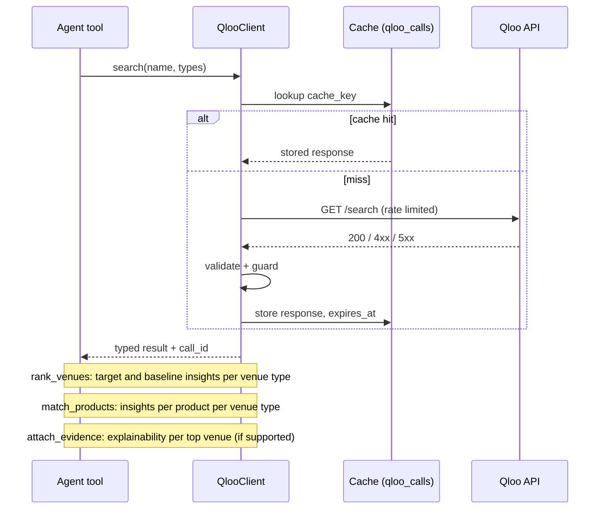

# 04. Qloo integration

Qloo is the core of Stockist Scout: it decides **which venues**, **which product** and **why**. This file defines the integration boundary, the call chain, normalisation, verification and budget.

## Status of facts in this file

| Fact | Status |
|---|---|
| Base URL `https://hackathon.api.qloo.com`, header `X-Api-Key` | From earlier research; verify in Phase 0 |
| Limits: 5 requests per second, 10,000 calls per month | From hackathon materials; verify |
| Endpoints `/search`, `/v2/insights`, `/v2/tags`, `/v2/audiences`, `/v2/analysis/compare` | From earlier research; verify |
| Parameters `filter.type`, `filter.location`, `filter.location.query`, `filter.location.radius`, `filter.tags`, `signal.interests.entities`, `signal.location`, `take` | From earlier research; verify each |
| Brands ignore `filter.location`; heatmap tracks popularity; invalid params can return 200 silently; tag search matches any word | Observed in earlier testing; re-check |
| Response field names (affinity, popularity, properties such as website or address, explainability output) | **Unknown until Phase 0.** Do not code against guesses |

**Rule:** Phase 0 records raw responses as fixtures and writes `docs/qloo-contract.md`. Pydantic models are built from the fixtures. When this file disagrees with live behaviour, live behaviour wins and this file is updated.

## Capability-to-feature map

| Qloo capability | Feature | Decision it drives |
|---|---|---|
| Entity search (`/search`) | F02 | Which Qloo entities represent each product |
| Tag search (`/v2/tags`) | F11, F03 | Which tags mean "café", "bar", "boutique" |
| Insights for places with location and interest signals | F03 | Which venues' customers match the products |
| Same query without signals (baseline) | F03 | Removes the "just popular" effect (lift) |
| Insights per product | F04 | Which product to lead with at each venue |
| Explainability (if available) or returned tags | F05 | The reason shown and cited in the pitch |
| Compare (`/v2/analysis/compare`) | Stretch | Two products' audiences compared, for portfolio reps |

## Call chain

Dependencies: `rank_venues` needs entity ids from `search`; `match_products` and `attach_evidence` need the venue set from `rank_venues`; drafts need the evidence.

## Client design (`qloo/client.py`)

- Async `httpx.AsyncClient`, base URL and header from settings, timeout `QLOO_TIMEOUT_SECONDS`.
- **Token bucket** at `QLOO_RPS` (default 4, below the 5 per second limit), shared process-wide.
- **Retries:** on 429, 502, 503, 504 and timeouts; exponential backoff 0.5 s, 1 s, 2 s with jitter; maximum 3 attempts. No retry on 400, 401, 403.
- **Cache:** key = SHA-256 of method, path and sorted query params (API key excluded). Stored with response body, status and `expires_at`.
- **Budget:** per-run counter checked before each live call against `QLOO_MAX_CALLS_PER_RUN`; monthly counter checked before starting a run (F10).
- **Trace:** every call (live or cached) inserts a `qloo_calls` row: run_id, step, endpoint, params (no key), status, duration, cache_hit, result_count, warnings.
- **Typed errors:** `QlooAuthError`, `QlooRateLimited`, `QlooUnavailable`, `QlooBadRequest`, `QlooBudgetExceeded`, `QlooContractViolation`.

## Guards against silent failures

After every response:
1. The response shape matches the Pydantic model built from fixtures.
2. Returned entity types match `filter.type`.
3. For location queries, every entity's coordinates are within the radius (with 10% tolerance).
4. For tag-filtered queries, every entity carries one of the requested tags (if tags are returned).
5. If more than 30% of entities fail 2–4, raise a warning; if 100% fail, raise `QlooContractViolation`.

## Normalisation

- Affinity (or whatever ranking field the contract provides) is converted to a **percentile rank within its own query** (0–1). If the API returns only an order, use rank position: `pct = 1 - (rank - 1) / n`.
- Lift, fit and confidence are computed in `scoring/` exactly as defined in F03 and F04.
- `scoring_version` is stored with each run.

## Baseline experiment (Phase 0)

Run the café query in the demo city three ways: (a) no interest signal, (b) a fixed set of broadly popular brands as signal, (c) the demo brand's entities. Measure Spearman correlation between (c) and (a), and (c) and (b). Choose the baseline (a or b) that best represents "general popularity" (higher correlation with review-count proxies if available, otherwise (a)). Record the decision in the decisions log.

## Kill switch (must pass)

With `QLOO_API_KEY` empty or invalid, a new run fails in the scout phase with `qloo_unconfigured` or `qloo_auth`. No venue ranking, product fit, reasons or drafts are produced, and no LLM drafting call is made. The sample run still loads because it is stored data, and it is labelled as stored.

## Budget per run (typical)

| Step | Calls |
|---|---|
| Resolve 3 products, 2 with comparables (3 suggestions each) | 3 + 6 = 9 |
| Rank 4 venue types (target + baseline) | 8 |
| Product fit, 3 products × 4 types | 12 |
| Explainability for top 30 (if per-venue calls are required) | up to 30 |
| **Total** | about 30 to 60 |

`QLOO_MAX_CALLS_PER_RUN=120` leaves headroom. At about 50 calls per cold run, 10,000 calls allow about 200 cold runs per month; cached runs cost far less.

## Testing Qloo

- **Contract tests** parse every fixture with the Pydantic models.
- **Unit tests** cover normalisation, guards and error mapping.
- **Integration tests** use respx to simulate 429, 500, timeouts, empty results and silent failures.
- **Live smoke test** (`pytest -m live`): one cached-friendly run for the demo city. Never in CI.
- **Evaluation**: Qloo-on versus Qloo-off (see `15-evaluation.md`).

## What Qloo does not provide (do not assume)

Company databases, decision-makers, email addresses, purchase intent, sales predictions. Those come from other services or are out of scope. Affinity is not demand; the UI says "taste fit", never "will buy".
