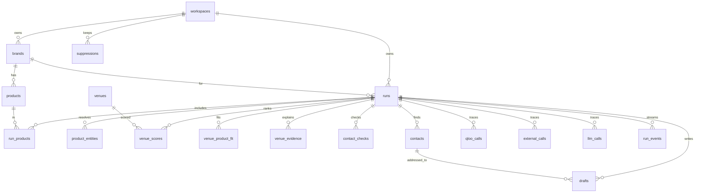

# 06. Data model (Supabase Postgres)

## Principles

- Supabase Postgres is the only datastore: app data, the response cache, the call trace and run events.
- Schema lives in SQL migrations under `supabase/migrations/`, created with `supabase migration new <name>` and applied with `supabase db push` (cloud) or `supabase db reset` (local). Never change the schema by hand in the dashboard.
- **Row Level Security is enabled on every table with no policies.** The anon and authenticated roles therefore read nothing. Only FastAPI, connecting with `DATABASE_URL`, touches data.
- Every user-owned row carries `workspace_id`. Every repository function takes `workspace_id` and filters by it.
- Raw provider responses are stored for traceability and caching, with expiry dates.

## Entity relationships



## Migration `0001_init.sql`

```sql
create extension if not exists citext;

create table workspaces (
  id uuid primary key default gen_random_uuid(),
  kind text not null default 'anon' check (kind in ('anon','demo')),
  created_at timestamptz not null default now(),
  last_seen_at timestamptz not null default now()
);

create table brands (
  id uuid primary key default gen_random_uuid(),
  workspace_id uuid not null references workspaces(id) on delete cascade,
  name text not null,
  website_url text,
  category text not null check (category in ('food_drink','fashion','unsupported')),
  profile jsonb not null,
  unsupported_override boolean not null default false,
  source_text text,
  source_text_expires_at timestamptz,
  confirmed_at timestamptz,
  created_at timestamptz not null default now()
);

create table products (
  id uuid primary key default gen_random_uuid(),
  workspace_id uuid not null references workspaces(id) on delete cascade,
  brand_id uuid not null references brands(id) on delete cascade,
  name text not null,
  kind text,
  notes text,
  position smallint not null default 0,
  created_at timestamptz not null default now()
);

create table runs (
  id uuid primary key default gen_random_uuid(),
  workspace_id uuid not null references workspaces(id) on delete cascade,
  brand_id uuid not null references brands(id) on delete cascade,
  city jsonb not null,                       -- {name, country, lat, lon, bbox:[s,w,n,e], radius_m}
  venue_types text[] not null,
  status text not null default 'queued'
    check (status in ('queued','running','scouted','outreach_running','done','failed')),
  phase text check (phase in ('scout','outreach')),
  orchestration text check (orchestration in ('agent','planner','deterministic_fallback')),
  orchestration_reason text,
  scoring_version text not null,
  settings jsonb not null default '{}',      -- weights, thresholds, limits used
  counters jsonb not null default '{}',      -- qloo_live, qloo_cached, hunter, overpass, llm
  client_ip_hash text,
  error_code text,
  error_message text,
  created_at timestamptz not null default now(),
  started_at timestamptz,
  finished_at timestamptz
);
create index runs_workspace_idx on runs(workspace_id, created_at desc);
create index runs_ip_day_idx on runs(client_ip_hash, created_at);

create table run_products (
  run_id uuid not null references runs(id) on delete cascade,
  product_id uuid not null references products(id) on delete cascade,
  primary key (run_id, product_id)
);

create table qloo_calls (
  id uuid primary key default gen_random_uuid(),
  run_id uuid references runs(id) on delete set null,
  step text not null,
  endpoint text not null,
  params jsonb not null,                     -- never contains the API key
  cache_key text not null,
  cache_hit boolean not null default false,
  status integer,
  duration_ms integer,
  result_count integer,
  warnings jsonb not null default '[]',
  response jsonb,                            -- stored only for live calls
  expires_at timestamptz,
  created_at timestamptz not null default now()
);
create index qloo_cache_idx on qloo_calls(cache_key, expires_at desc) where cache_hit = false and status = 200;
create index qloo_run_idx on qloo_calls(run_id, created_at);
create index qloo_month_idx on qloo_calls(created_at) where cache_hit = false;

create table external_calls (
  id uuid primary key default gen_random_uuid(),
  run_id uuid references runs(id) on delete set null,
  service text not null check (service in ('website','nominatim','overpass','hunter','apollo','photon','web_search')),
  endpoint text not null,
  params jsonb not null,
  cache_key text not null,
  cache_hit boolean not null default false,
  status integer,
  duration_ms integer,
  response jsonb,
  expires_at timestamptz,
  created_at timestamptz not null default now()
);
create index external_cache_idx on external_calls(service, cache_key, expires_at desc) where cache_hit = false;
create index external_run_idx on external_calls(run_id, created_at);

create table llm_calls (
  id uuid primary key default gen_random_uuid(),
  run_id uuid references runs(id) on delete set null,
  purpose text not null,                     -- brand_profile, comparables, agent_step, pitch, repair
  provider text not null,
  model text not null,
  prompt_version text not null,
  status text not null,                      -- ok, invalid, error, timeout
  duration_ms integer,
  input_tokens integer,
  output_tokens integer,
  created_at timestamptz not null default now()
);

create table product_entities (
  id uuid primary key default gen_random_uuid(),
  run_id uuid not null references runs(id) on delete cascade,
  product_id uuid not null references products(id) on delete cascade,
  qloo_entity_id text not null,
  name text not null,
  entity_type text not null,
  role text not null check (role in ('self','comparable')),
  similarity numeric(4,3),
  source_call_id uuid references qloo_calls(id),
  created_at timestamptz not null default now(),
  unique (run_id, product_id, qloo_entity_id)
);

create table venues (
  id uuid primary key default gen_random_uuid(),
  qloo_entity_id text not null unique,
  name text not null,
  lat double precision,
  lon double precision,
  address text,
  tags jsonb not null default '[]',
  properties jsonb not null default '{}',
  osm_ref text,
  website text,
  updated_at timestamptz not null default now()
);

create table venue_scores (
  run_id uuid not null references runs(id) on delete cascade,
  venue_id uuid not null references venues(id) on delete cascade,
  venue_type text not null,
  target_pct numeric(5,4) not null,
  baseline_pct numeric(5,4) not null,
  lift numeric(5,4) not null,
  fit numeric(5,4) not null,
  confidence text not null check (confidence in ('high','medium','low')),
  flags text[] not null default '{}',
  rank integer not null,
  primary key (run_id, venue_id)
);
create index venue_scores_rank_idx on venue_scores(run_id, rank);

create table venue_product_fit (
  run_id uuid not null references runs(id) on delete cascade,
  venue_id uuid not null references venues(id) on delete cascade,
  product_id uuid not null references products(id) on delete cascade,
  percentile numeric(5,4) not null,
  is_best boolean not null default false,
  margin numeric(5,4),
  label text check (label in ('clear','close','tie','single_product','unscored')),
  primary key (run_id, venue_id, product_id)
);

create table venue_evidence (
  id uuid primary key default gen_random_uuid(),
  run_id uuid not null references runs(id) on delete cascade,
  venue_id uuid not null references venues(id) on delete cascade,
  type text not null check (type in ('qloo_affinity','qloo_explanation','qloo_tag_overlap','osm_fact','contact_source','inference')),
  label text not null,
  value jsonb not null,
  source_kind text not null check (source_kind in ('qloo','external','inference')),
  source_call_id uuid,                       -- qloo_calls.id or external_calls.id
  captured_at timestamptz not null default now()
);
create index venue_evidence_idx on venue_evidence(run_id, venue_id);

create table contact_checks (
  run_id uuid not null references runs(id) on delete cascade,
  venue_id uuid not null references venues(id) on delete cascade,
  status text not null check (status in ('found','none','limit_reached','suppressed','skipped_social','error')),
  checked_sources jsonb not null default '[]',
  checked_at timestamptz not null default now(),
  primary key (run_id, venue_id)
);

create table contacts (
  id uuid primary key default gen_random_uuid(),
  workspace_id uuid not null references workspaces(id) on delete cascade,
  run_id uuid not null references runs(id) on delete cascade,
  venue_id uuid not null references venues(id) on delete cascade,
  email citext not null,
  role text,
  type text check (type in ('personal','generic')),
  source text not null check (source in ('hunter','osm','qloo','apollo','website','web')),
  confidence integer,
  verification_status text,
  sources jsonb not null default '[]',
  is_primary boolean not null default false,
  found_at timestamptz not null default now(),
  unique (run_id, venue_id, email)
);

create table drafts (
  id uuid primary key default gen_random_uuid(),
  workspace_id uuid not null references workspaces(id) on delete cascade,
  run_id uuid not null references runs(id) on delete cascade,
  venue_id uuid not null references venues(id) on delete cascade,
  contact_id uuid not null references contacts(id) on delete cascade,
  subject text not null,
  body text not null,
  cited_evidence_ids uuid[] not null default '{}',
  source text not null check (source in ('llm','template')),
  status text not null default 'draft' check (status in ('draft','edited','approved','exported')),
  model text,
  prompt_version text,
  created_at timestamptz not null default now(),
  updated_at timestamptz not null default now(),
  approved_at timestamptz,
  exported_at timestamptz,
  unique (run_id, venue_id, contact_id)
);

create table suppressions (
  id uuid primary key default gen_random_uuid(),
  workspace_id uuid not null references workspaces(id) on delete cascade,
  kind text not null check (kind in ('email','domain')),
  value citext not null,
  reason text not null check (reason in ('opt_out','bounced','claimed_email','manual')),
  created_at timestamptz not null default now(),
  unique (workspace_id, kind, value)
);

create table run_events (
  id bigserial primary key,
  run_id uuid not null references runs(id) on delete cascade,
  seq integer not null,
  type text not null,
  payload jsonb not null default '{}',
  created_at timestamptz not null default now(),
  unique (run_id, seq)
);

create table evaluations (
  id uuid primary key default gen_random_uuid(),
  run_id uuid references runs(id) on delete set null,
  method text not null,
  results jsonb not null,
  created_at timestamptz not null default now()
);

-- Lock everything down: RLS on, no policies.
do $$
declare t text;
begin
  foreach t in array array['workspaces','brands','products','runs','run_products','qloo_calls',
    'external_calls','llm_calls','product_entities','venues','venue_scores','venue_product_fit',
    'venue_evidence','contact_checks','contacts','drafts','suppressions','run_events','evaluations']
  loop
    execute format('alter table %I enable row level security', t);
  end loop;
end $$;
```

## Validation rules (enforced in the API, backed by constraints)

- Products per brand: 1–5. Venue types per run: 1–6. Outreach venues per run: up to `MAX_OUTREACH_VENUES_PER_RUN`.
- Emails stored only from sources (never constructed); citext for case-insensitive uniqueness.
- `params` in call tables must not contain secrets (unit test on the serializer).

## Retention (run by `scripts/cleanup.py`, daily, for example as a scheduled job on the API host)

| Data | Kept for |
|---|---|
| `brands.source_text` | 30 days after `source_text_expires_at` |
| Raw `response` in `qloo_calls` and `external_calls` | Until `expires_at` plus 7 days, then set to null (trace row stays) |
| Anonymous workspaces with no activity | 60 days, then deleted with cascade (suppressions included) |
| Demo workspace | Kept |

## Connection notes

- Use asyncpg. If `DATABASE_URL` is the Supavisor **transaction** pooler, pass `statement_cache_size=0` to `create_pool()` and do not call `Connection.prepare()`. A long-running FastAPI server can use the direct connection or the **session** pooler instead.
- Pool size 5–10 for the hackathon host.
- Supabase local development (`supabase start`) needs Docker. Without Docker, use a separate Supabase cloud project for development and another for production.
